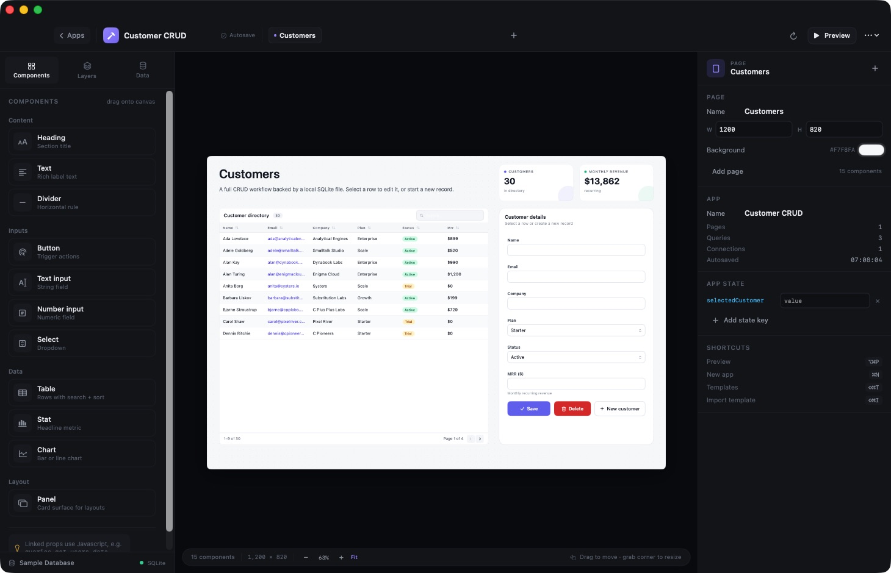
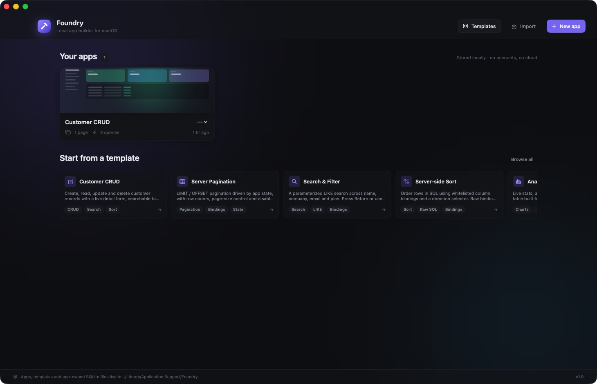
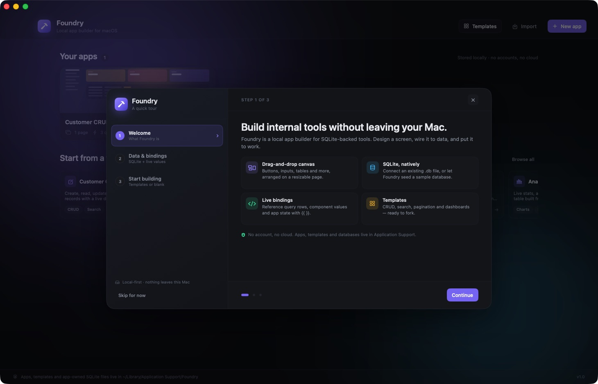
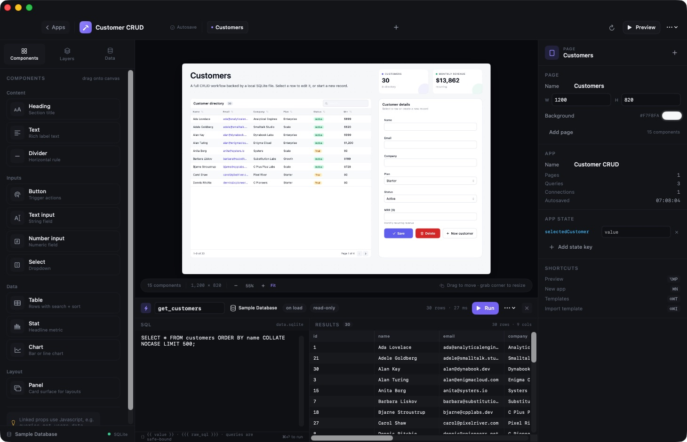
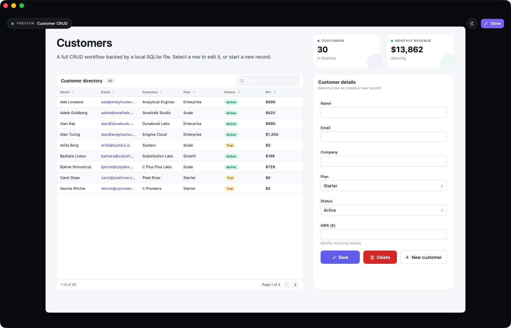
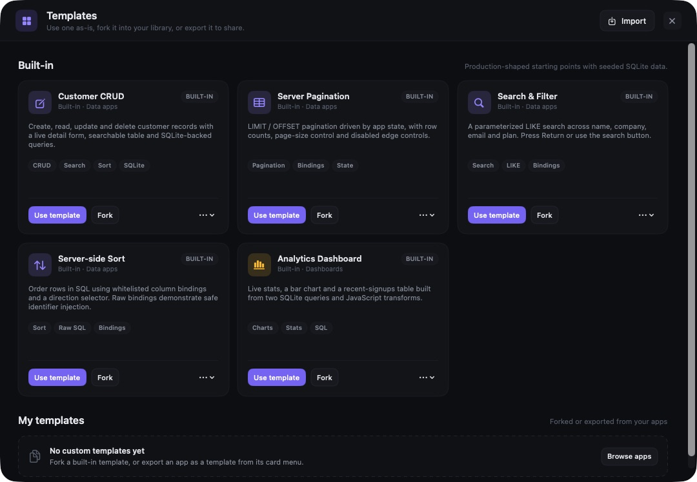
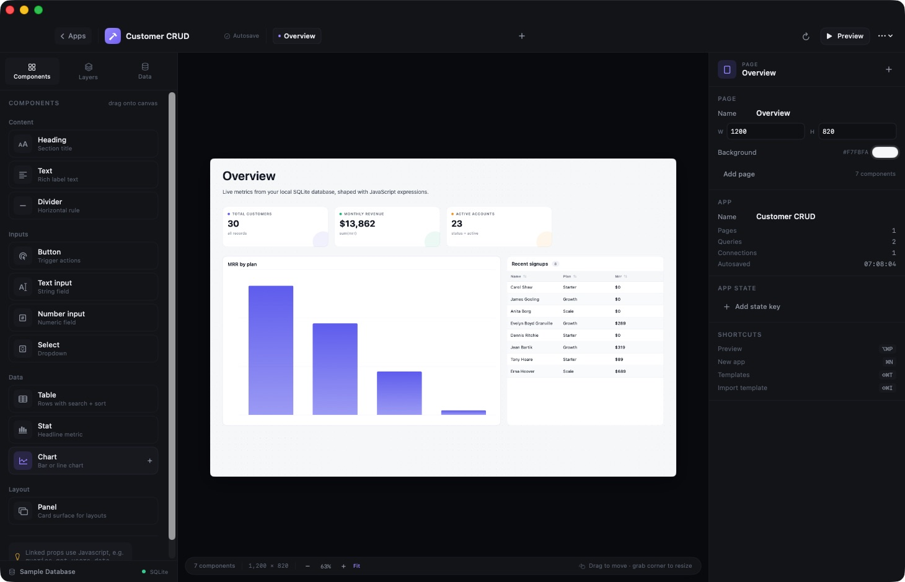

# Foundry

Foundry is a local-first macOS app builder in the spirit of Retool. Design screens on a drag-and-drop canvas, connect SQLite databases, bind data with JavaScript expressions, and ship internal tools without a backend or an account.



Everything runs on your Mac. Apps, templates, and their SQLite files are stored in `~/Library/Application Support/Foundry`.

## Contents

- [Requirements](#requirements)
- [Build and run](#build-and-run)
- [Quick start](#quick-start)
- [First-run tour](#first-run-tour)
- [The editor](#the-editor)
- [Components](#components)
- [Bindings](#bindings)
- [Events and actions](#events-and-actions)
- [Queries and SQLite](#queries-and-sqlite)
- [Tables](#tables)
- [Preview](#preview)
- [Templates](#templates)
- [Cloning, forking, exporting](#cloning-forking-exporting)
- [Keyboard shortcuts](#keyboard-shortcuts)
- [Data storage](#data-storage)
- [Development](#development)
- [Troubleshooting](#troubleshooting)

## Requirements

- macOS 14 Sonoma or later
- Xcode 16 or a Swift 6 toolchain to build
- No accounts, network access, or external services

## Build and run

```sh
git clone https://github.com/theikbhal/foundry-mac.git
cd foundry-mac

./scripts/run.sh              # debug build + launch
# or
./scripts/build-app.sh release
open dist/Foundry.app
```

`scripts/build-app.sh` produces `dist/Foundry.app` and ad-hoc signs it. There is no `.xcodeproj`; the app is a SwiftPM executable packaged into a bundle.

## Quick start

1. Launch Foundry and open **Customer CRUD** from the template list, or choose **New app**.
2. Open the **Data** tab in the left sidebar. Templates already include a seeded SQLite connection.
3. Press **Run** in a query, or use `⌘⏎`, to inspect results.
4. Select a component and edit its properties in the inspector on the right.
5. Press **Preview** (`⌥⌘P`) to use the app as an end user would.



## First-run tour

On first launch, Foundry opens a three-step tour: what the builder does, how SQLite queries connect to component bindings, and where to start from a template or a blank canvas. The tour appears once and is remembered per user.



Close or skip it at any time, or reopen it later from **Help → Welcome to Foundry**. The final step can jump straight into a template or create a blank app.

## The editor

The editor has four regions:

- **Sidebar** — Components palette, Layers list, and Data panel.
- **Canvas** — the page being designed. Drag components in, move them, or resize with the corner handle.
- **Query panel** — opens under the canvas when a query is selected.
- **Inspector** — layout, properties, events, visibility, page settings, app state, and shortcuts.

Canvas behavior:

- Drag a palette item onto the canvas, or click it to add at the next free spot.
- Components snap to an 8-point grid and are clamped to the page bounds.
- Select a component to see a name tag, selection border, and resize handle.
- Right-click for duplicate, bring to front, send to back, hide, lock, and delete.
- Zoom from 30% to 160% with the bottom bar; **Fit** sizes the page to the viewport.
- Add pages, rename them, and set page width, height, and background in the page inspector.

## Components

| Component | Purpose | Events |
| --- | --- | --- |
| Heading | Page title text | — |
| Text | Body copy, supports bindings | — |
| Divider | Horizontal rule | — |
| Button | Primary, secondary, ghost, or danger actions | on click |
| Text input | Single-line text field | on submit |
| Number input | Numeric field, parses numbers into component state | on submit |
| Select | Dropdown from `{label, value}` options | on change |
| Table | Data grid with search, sort, pagination, row selection | on row click |
| Stat | Headline metric with accent color and caption | — |
| Chart | Bar, line, or area chart via Swift Charts | — |
| Panel | Titled card surface for grouping | — |

Every component supports position, size, stacking, lock, hide, and a set of typed properties. Text-like properties can be literal values or `{{ }}` expressions; toggle **fx** in the inspector to switch.

## Bindings

Bindings are JavaScript expressions evaluated against the current app state.

```text
{{ queries.get_customers.data }}
{{ state.selectedCustomer ? state.selectedCustomer.name : '' }}
{{ formatCurrency(sum(queries.get_customers.data, 'mrr')) }}
```

Available context:

| Path | Contents |
| --- | --- |
| `queries.<name>.data` | Array of row objects |
| `queries.<name>.columns` | Column names |
| `queries.<name>.rowCount` | Number of returned rows |
| `queries.<name>.affectedRows` | Rows changed by a write |
| `queries.<name>.error` | Error message, or `null` |
| `queries.<name>.loading` | Whether the query is running |
| `queries.<name>.durationMS` | Last run time |
| `state.<key>` | App state, persisted with the app |
| `components.<name>.value` | Current input value |
| `components.<name>.search` | Table search text |
| `components.<name>.page` | Table page |
| `components.<name>.sortKey` | Table sort column |
| `components.<name>.sortAscending` | Table sort direction |
| `components.<name>.selectedRow` | Selected table row |
| `page`, `app` | Current page and app metadata |

Helper functions: `formatDate`, `formatDateTime`, `formatCurrency`, `formatNumber`, `formatPercent`, `sum`, `avg`, `count`, `unique`, `groupBy`, `upper`, `lower`, `titleCase`, `round`, `today`, `json`.

In SQL, single braces produce an **escaped SQL literal** and are the safe choice for values:

```sql
SELECT * FROM customers
WHERE name LIKE '%' || {{ components.searchInput.value }} || '%';
```

Triple braces insert **raw SQL** and are only for identifiers or clauses. Always whitelist the value:

```sql
ORDER BY {{{ (["name", "company", "plan", "mrr"].indexOf(state.sortKey) >= 0
  ? state.sortKey : "name") + " " + (state.sortDir === "desc" ? "DESC" : "ASC") }}}
```

## Events and actions

Buttons, inputs, and tables expose events. Each event runs an ordered list of actions:

- **Run query** — execute a query by name.
- **Set app state** — write a value to `state`.
- **Set component value** — write an input's current value.
- **Show toast** — display a confirmation or error message.
- **Open URL** — open a link in the default browser.
- **Go to page** — navigate to another page.

Values can be literals or expressions. Table row-click actions receive the clicked row as `row`:

```text
state.selectedCustomer = {{ row }}
components.customerName.value = {{ row.name ?? '' }}
```

## Queries and SQLite

The Data tab manages connections, schema, queries, and app state.

- **Folder** opens an existing `.sqlite`/`.db` file; **plus** creates a new database.
- Each connection shows its tables and columns with row counts.
- **+** beside a table creates a `SELECT` query for it.
- Queries declare a connection, whether they run on app load, and whether they are read-only.
- **Read-only** queries open the database in read-only mode; use the query menu's **Allow writes** toggle for `INSERT`, `UPDATE`, or `DELETE`.
- Run with `⌘⏎`. Results show row/column counts, timing, errors, and affected rows for writes.
- Write queries support `INSERT`, `UPDATE`, `DELETE`, and multi-statement SQL, including `ON CONFLICT ... DO UPDATE`.



Input components are seeded with their configured defaults before on-load queries run, so an empty search field or untouched form binds an empty string rather than `NULL`.

## Tables

Tables read from a data expression and have client-side behavior:

- **Searchable** — filters across all visible values.
- **Sortable** — click a header to sort, click again to reverse.
- **Paginate** — page size and a range footer (`1–9 of 30`, page controls).
- **Columns** — comma-separated keys; leave empty to infer from the data.
- **Striped rows** and a configurable empty-state message.
- Clicking a row selects it and runs the table's row-click actions.

For server-side pagination or sorting, bind the table to a query and drive it from `state` (see the Server Pagination and Server-side Sort templates).

## Preview

Preview (`⌥⌘P` or the toolbar button) renders the active page without editor chrome. Inputs, selects, table search/sort/pagination, and actions are live. Hidden components are excluded. Press **Esc** or **Done** to return.



## Templates

Five built-in templates cover common internal-tool patterns. Each seeds its own SQLite database.

| Template | What it demonstrates |
| --- | --- |
| Customer CRUD | Table + detail form with insert, update, and delete |
| Server Pagination | `LIMIT`/`OFFSET` driven by `state.page` and `state.pageSize` |
| Search & Filter | Escaped `LIKE` search across several columns |
| Server-side Sort | Whitelisted `ORDER BY` built with a raw binding |
| Analytics Dashboard | Stats, Swift Charts bar chart, and recent rows |



The dashboard template running against the sample data:



## Cloning, forking, exporting

- **Clone app** (card menu or app menu) duplicates the app, its pages, queries, and its SQLite database.
- **Fork** on a template copies it into **My templates**, where it can be edited independently.
- **Export as template** from an app writes a `.foundrytemplate` file containing the UI and a SQL dump of its database.
- **Import template** (`⇧⌘I`) adds a `.foundrytemplate` file to My templates.
- Use a template from the gallery to create a fresh app with its own database copy.

## Keyboard shortcuts

| Action | Shortcut |
| --- | --- |
| Preview | `⌥⌘P` |
| Exit preview | `Esc` |
| Run query | `⌘⏎` |
| New app | `⌘N` |
| Browse templates | `⇧⌘T` |
| Import template | `⇧⌘I` |
| Back to apps | `⇧⌘B` |

## Data storage

Foundry stores everything under `~/Library/Application Support/Foundry`:

```text
Foundry/
├── Apps/          # One JSON document per app
├── Templates/     # User templates (forks and imports)
└── Databases/
    └── <app-id>/  # App-owned SQLite files
```

Apps autosave shortly after edits. Deleting an app also deletes its database directory.

## Development

Build, run, and verify:

```sh
swift build
./scripts/build-app.sh debug
./dist/Foundry.app/Contents/MacOS/Foundry --selftest /tmp/foundry-selftest.json
```

The self-test instantiates every built-in template, exercises CRUD, pagination, search escaping, sorting, cloning, fork, and export/import, writes a JSON report, and exits `0` only if all checks pass.

Launch flags used for development:

| Flag | Purpose |
| --- | --- |
| `--demo` | Open the sample CRUD app |
| `--preview` | Combine with `--demo` to start in preview |
| `--query` | Combine with `--demo` to open the first query |
| `--dashboard` | Combine with `--demo` to preview the dashboard layout |
| `--templates` | Open the template gallery at launch |
| `--onboarding` | Show the first-run tour even if it was already completed |
| `--onboarding-step <n>` | Open the tour at step `n` (0–2); combine with `--onboarding` |
| `--snapshot <path>` | Render the app to a PNG and exit (dev screenshot helper) |
| `--selftest <path>` | Run the functional template tests and exit |

Project layout:

```text
Sources/Foundry/
├── App/           # App entry point and dev snapshot/self-test hooks
├── Data/          # SQLite C API wrapper and schema introspection
├── Dev/           # Self-test harness
├── Engine/        # Editor model, JS evaluation, runtime context
├── Models/        # App documents, templates, component schema, JSON
├── Persistence/   # App/template storage and cloning
├── Templates/     # Built-in templates and seed data
└── UI/            # Gallery, canvas, inspector, query panel, sidebar
```

## Troubleshooting

**A query says no connection is attached.** Select a connection in the query panel or reattach it from the menu; imported templates without a seed database have no connection.

**The app list is empty after a reset.** Apps live in Application Support. Quit Foundry, remove `~/Library/Application Support/Foundry` if you want a clean slate, and relaunch.

**A search or save inserts empty values.** Components start with their configured default values; set explicit defaults in the inspector when a form should begin with data.

**The welcome tour never appears.** It is remembered in user defaults after the first close. Reopen it from **Help → Welcome to Foundry**, or reset the flag while the bundled app is closed:

```sh
defaults delete app.foundry.local foundry.onboarding.completed
```

**Preview looks different from the canvas.** Preview renders at 100% with no zoom, grid, selection borders, or hidden components. Zoom controls only affect the design canvas.

**Build fails on an older macOS or Xcode.** Foundry targets macOS 14 and Swift tools 6.0 (Swift 5 language mode). Update Xcode or the toolchain.
